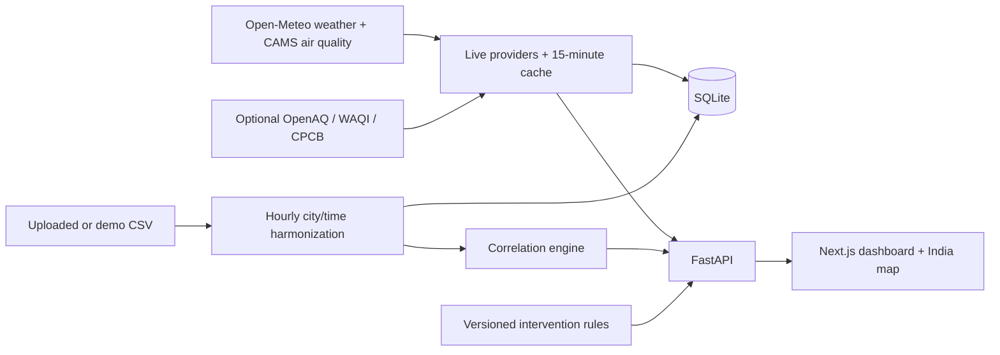

# NexusData

NexusData is an India-focused exploratory data platform. It combines uploaded CSVs on time and city, displays live model weather and air-quality data for 28 Indian cities, and surfaces statistical relationships and evidence-labeled development suggestions. It is **indicative analysis for exploration, not official policy guidance**.



## Run

The no-key path uses Open-Meteo. Install Docker, then run from the repository root:

```bash
docker compose up --build
```

Open [http://localhost:3000](http://localhost:3000). The API is at [http://localhost:8000/docs](http://localhost:8000/docs); [http://localhost:8000/health](http://localhost:8000/health) is the health check. The first map load requests two Open-Meteo batches and may take several seconds. If the source is unreachable, a persisted snapshot is shown as stale when available.

For local development without Docker:

```bash
cd backend
python -m venv venv
venv/Scripts/pip install -r requirements-dev.txt
venv/Scripts/uvicorn main:app --reload
# in a second terminal
cd frontend
npm ci
npm run dev
```

On macOS/Linux, replace `venv/Scripts/` with `venv/bin/`. The frontend uses `NEXT_PUBLIC_API_URL` if the API is not at `http://127.0.0.1:8000`.

## Main flows

- The India map shows model weather, model pollutants, an Indian AQI **estimate**, city focus areas, and state averages. Clicking a city opens its 48-hour series, correlations, station observations when configured, rule-triggered suggestions, and a scenario control.
- Upload CSVs with a time column, numeric fields, and optionally a city column. The pipeline detects and normalizes keys, resamples to hourly means, performs an outer merge, and ranks numeric associations. Add `?include_live=true` to the upload or demo endpoint to merge current live history into this pipeline.
- The demo uses AQI and weather files plus `demo_load_overlap.csv`, a **synthetic** Bengaluru load series aligned to the same 2026 period. The lineage tab reports the shared time window. The original historical load file remains available for manual upload.
- Gemini is optional. It only explains supplied statistical evidence and cannot calculate or modify statistics.

## Configuration

Copy [.env.example](.env.example) to `.env` for Docker, or use [backend/.env.example](backend/.env.example) for local backend settings. All keys are optional. `OPENAQ_API_KEY` enables latest station pollutants; `WAQI_TOKEN` enables a station feed; `DATA_GOV_IN_KEY` plus `DATA_GOV_IN_RESOURCE_ID` enables the provisional CPCB adapter; `GEMINI_API_KEY` enables narrative insights. `CORS_ORIGINS` is a comma-separated list. `NEXUSDATA_DB_PATH` selects the SQLite path. `DEVELOPMENT_WEIGHTS` is a JSON object of the four scoring weights.

## Verification

```bash
cd backend && venv/Scripts/python -m pytest -q
cd frontend && npm test && npm run lint && npm run build
```

## Sources and limitations

See [data attribution](docs/DATA_SOURCES.md), [scoring and scenario methodology](docs/METHODOLOGY.md), and [implementation decisions](docs/DECISIONS.md). Model data can differ from local station readings. Correlations and scenario projections do not establish causation. The city registry's population and area values are reference estimates; boundaries are display geometry. The data.gov.in adapter is provisional. The live cache is per backend process, while merged data and live history persist in SQLite.

## Screenshots

<!-- Add an India map screenshot here after UI review. -->
<!-- Add a city detail and scenario screenshot here after UI review. -->
